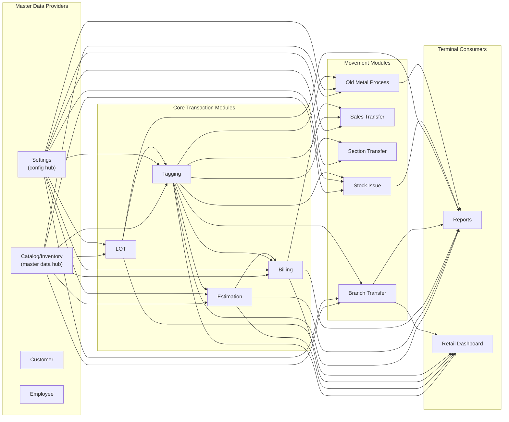
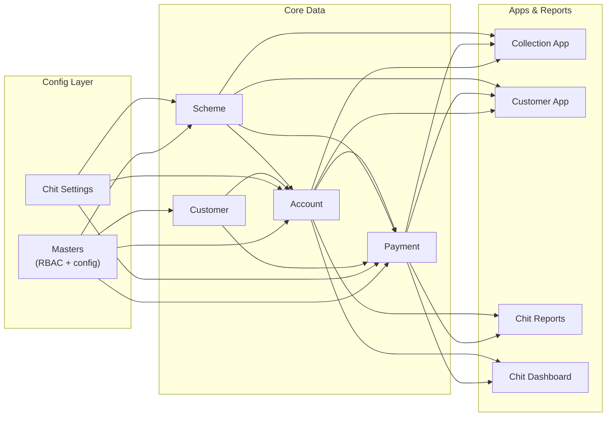

# Module Dependencies Map

> Which modules depend on which. Use this before modifying any shared code.
> Last updated: 2026-07-02 (Full Refresh — 28 modules scanned)

---

## Dependency Matrix — Retail Core

| Module | Depends On | Depended On By |
|---|---|---|
| **Billing** | Estimation, Tagging, Customer, Settings, Orders, Tax, Gift Voucher, Scheme/Chit, Purchase, Wallet, Accounts, Metal Rates, Inventory (Non-Tag) | Reports, Sales Transfer, Retail Dashboard |
| **Estimation** | Tagging, Customer, Settings, Orders, Billing (tax endpoint), Catalog, Accounts/Chit, Day Closing, Gift Voucher, Sales Return, Credit Collection | Billing, Reports, Retail Dashboard, Section Transfer |
| **Tagging** | Settings, Billing (status check), Branch Transfer (trans code), Catalog (products), LOT (balance deduction), Estimation (AJAX), Metal Process | Billing, Estimation, Reports, Branch Transfer, Sales Transfer, Section Transfer, Stock Issue, Customer Order, Purchase, Old Metal, LOT |
| **Reports (Ret_Reports)** | Billing, Tagging, Purchase/PO, GRN, LOT, Catalog, Customer, Branch Transfer, Issue Receipt, Karigar, Estimation, Purchase Returns, Old Metal, Stock Issue, Scheme/Chit, HR, Tax, Section, Ledger, Repair, Day Closing, Non-Tag, Settings | Retail Dashboard (cross-model), Section Transfer (AJAX), Catalog_Inventory (AJAX) |
| **Branch Transfer** | Tagging, Non-Tag, Billing, Purchase, Orders/Repairs, Packaging (Other Inventory), Catalog (AJAX), Mobile App API, Settings, SMS | Reports, Sales Transfer (AJAX), Stock Issue, Section Transfer (AJAX) |
| **Stock Issue** | Estimation (AJAX employee), Catalog (AJAX karigar), Settings, Tagging, LOT, Branch Transfer, Customer Order, SMS, Log | Reports |
| **Sales Transfer** | Billing (model), Tagging (AJAX rates), Catalog (AJAX), Branch Transfer (AJAX), Settings | Reports |
| **LOT** | Settings, Catalog, Tagging, Purchase/GRN, Old Metal, Orders, Non-Tag Inventory, HR, Karigar, Branch | Tagging, Estimation, Stock Issue, Reports, Sales Transfer |
| **Section Transfer** | Settings, Reports (AJAX), Catalog (AJAX), Branch Transfer (AJAX), Customer Order, Estimation | Reports |
| **Old Metal Process** | Billing, Estimation, Tagging, Catalog, Purchase, Settings, Stock Process | LOT, Reports |
| **Catalog_Inventory** | Settings, Tagging (delete guards), SMS, Log, Billing (bank deposit) | ALL retail modules (master data provider) |
| **Other Inventory** | Settings, Billing, Customer, Employee, Catalog, Day Closing, Branch Transfer, Scheme/Chit, Karigar, Log | Billing, Branch Transfer, Reports |
| **Retail Dashboard** | Estimation, Billing, Tagging, LOT, Branch Transfer, Customer Orders, Non-Tag, Finance/Receipts, Gift, Customer, Ledger, Settings, Reports (cross-model), Purchase, Catalog | — (terminal consumer) |
| **Retail Settings** | Customer, Scheme, Account | ALL retail modules (config provider) |
| **Purchase** | Catalog (20+ AJAX), Tagging (stone items), Orders, Settings, Reports, Billing (cheque printing), Purchase Approval, Dashboard | LOT, Reports, Old Metal, Retail Dashboard |
| **Customer Order** | Settings, Billing (rates AJAX), Karigar/Purchase Approval, Email, Tagging, Job Order, Log, Estimation, DOMPDF | Tagging, Estimation, LOT, Reports, Section Transfer, Stock Issue, Branch Transfer |
| **Customer** | Settings, Wallet, Log, SMS, Email, Estimation (village AJAX) | ALL modules (customer data) |
| **Employee** | Settings, Wallet, Log, Estimation (device count) | ALL modules (employee data), Login |

---

## Dependency Matrix — Chit/Scheme System

| Module | Depends On | Depended On By |
|---|---|---|
| **Account** | Payment, Customer, Settings, Scheme, Wallet, Employee, SMS, Email, Sync API, Chit API, Log | Chit Reports, Chit Dashboard, Collection App, Customer App |
| **Payment** | Settings, Account, Customer, Scheme, ChitAdmin, SMS, Email, Wallet, Sync API, DigiGold, Log, Billing (JS AJAX), Employee (JS AJAX), Branch (JS AJAX) | Account, Reports, Chit Dashboard, Collection App, Customer App |
| **Scheme** | Account, Settings, Payment, Log | Account, Payment, Chit Reports, Chit Dashboard, Collection App, Customer App |
| **Chit Reports** | Payment (model), Account (model), Admin Report Model, Dashboard Model, Settings, SMS, Log, Sync API, Integration (Khimji), Admin Manage (JS), Employee (JS), Customer (JS), Branch (JS) | — (terminal consumer) |
| **Chit Dashboard** | Dashboard Model, Services Model, Employee Model, Account Model, Settings, Customer (AJAX), Rate (AJAX), Branch (AJAX), Retail Dashboard (AJAX), Reports (AJAX) | — (terminal consumer) |
| **Collection App** | Mobile API Model, Payment Model, Scheme Model, Services Model, SMS, Email, Integration, Login, Sync API, Chit API | — (API layer, no owner tables) |
| **Customer App** | Mobile API Model, Payment Model, Scheme Model, Registration Model, Services Model, SMS, Email, DigiGold, Login, Sync API | — (API layer, no owner tables) |
| **Chit Settings** | Scheme, Customer, Account, Payment, ChitAdmin, SMS, Log | ALL chit modules (config provider) |
| **Masters** | Customer, Scheme, Account, ChitAdmin, SMS, Log | ALL modules (RBAC + config hub) |

---

## Dependency Graph — Retail Core



---

## Dependency Graph — Chit/Scheme System



---

## Cross-Module AJAX Calls

> JS files calling endpoints on external controllers. These are hidden dependencies
> that only break at runtime — not detectable from PHP model loading.

| Source Module | Target Controller | Endpoint | What Data | Risk |
|---|---|---|---|---|
| Estimation JS | `admin_ret_catalog` | `ret_product/active_list`, `get_active_design_products`, `get_ActiveSubDesigns`, `getLooseStoneProductRateSettings`, `getStoneRateSettings` | Products, designs, stone rates | Catalog change breaks estimation |
| Estimation JS | `admin_ret_billing` | `getAllTaxgroupItems` | Tax group items | Billing tax change breaks estimation |
| Estimation JS | `admin_ret_tagging` | `get_po_details`, `get_wastage_settings_details` | PO, wastage settings | Tagging change breaks estimation |
| Estimation JS | `admin_ret_other_inventory` | `get_productMappedDetails` | Packaging details | OI change breaks estimation |
| Estimation JS | `admin_settings` | `get_profession` | Profession list | Settings change breaks customer form |
| Estimation JS | `branch` | `branchname_list` | Branch names | — |
| Tagging JS | `admin_ret_billing` | `getAllTaxgroupItems` | Tax groups | Billing change breaks tagging |
| Tagging JS | `admin_ret_estimation` | `get_employee`, `getProductDesignBySearch` | Employee, design search | Estimation change breaks tagging |
| Purchase JS | `admin_ret_catalog` | 16+ endpoints | Products, designs, categories, karigars, purities, charges | Catalog change breaks purchase |
| Purchase JS | `admin_ret_tagging` | `get_ActiveSize`, `getStoneItems`, `getStoneTypes` | Size, stones | Tagging change breaks purchase |
| Branch Transfer JS | `admin_ret_catalog` | `product/active_prodBySearch`, `get_sectionBranchwise`, `karigar/active_list` | Products, sections, karigars | — |
| Branch Transfer JS | `admin_app_api` | `bt_approval_otp_req`, `update_aprvl_status`, `get_approval_status` | Mobile approval | App API change breaks BT |
| Stock Issue JS | `admin_ret_estimation` | `get_employee` | Employee list | Estimation change breaks SI |
| Stock Issue JS | `admin_ret_catalog` | `karigar/active_list` | Karigar list | — |
| Section Transfer JS | `admin_ret_reports` | `get_ActiveProduct` | Product list | Reports change breaks section transfer |
| Section Transfer JS | `admin_ret_catalog` | `get_sectionBranchwise` | Sections | — |
| Section Transfer JS | `admin_ret_brntransfer` | `getNonTaggedItem` | NT stock | BT change breaks section transfer |
| Sales Transfer JS | `admin_ret_tagging` | `get_metal_rates_by_branch` | Metal rates | — |
| Sales Transfer JS | `admin_ret_catalog` | `product/active_prodBySearch`, `category/active_category`, `ret_product/active_metal` | Products, categories, metals | — |
| Sales Transfer JS | `admin_ret_brntransfer` | `bt_get_branches`, `branch_transfer/getLotsByBranch`, `branch_transfer/getDesignByFilter` | Branches, lots, designs | — |
| Old Metal JS | `admin_ret_brntransfer` | `branch_transfer/getTagsByFilter` | Tag search | BT change breaks OMP |
| Old Metal JS | `admin_ret_purchase` | `karigarmaterialissue/available_stock_details` | Karigar stock | Purchase change breaks OMP |
| Old Metal JS | `admin_ret_reports` | `get_old_metal_type`, `get_ActiveProduct` | Metal types, products | Reports change breaks OMP |
| Catalog JS | `admin_ret_tagging` | `getStoneTypes` (2×) | Stone types | — |
| Catalog JS | `admin_ret_reports` | `get_ActiveSubDesign` | Sub-designs | — |
| Catalog JS | `admin_ret_purchase` | `karigar_gst_available`, `karigar_pan_available`, `karigar_aadhar_available` | Karigar ID checks | — |
| Catalog JS | `branch` | `branchname_list` (6×) | Branch list | — |
| Customer JS | `admin_ret_estimation` | `get_village`, `get_village_by_pincode` | Village lookup | Estimation change breaks customer |
| Customer JS | `settings/company` | `getcountry`, `getstate`, `getcity`, `getprofession`, `getlanguages` | Dropdowns | — |
| LOT JS | `admin_ret_catalog` | 15+ endpoints | All master data | — |
| Payment JS | `admin_ret_billing` | `get_bank_acc_details` (2×), `get_payment_device_details`, `get_advance_details`, `bill_payment_details` | Bank/POS/advance data | Billing change breaks payment |
| Payment JS | `admin_customer` | `ajax_get_scheme_account_list`, `ajax_get_customers_list` | Customer/account lists | — |
| Payment JS | `admin_employee` | `get_employee` | Employee list | — |
| Payment JS | `admin_scheme` | `ajax_get_schemes` | Active schemes | — |
| Retail Dashboard JS | `admin_ret_catalog` | `get_section` | Sections | — |
| Chit Dashboard JS | `admin_customer` | `get_customer_by_mobile` | Customer data | — |
| Chit Dashboard JS | `admin_reports` | `payment_summary_modewise` | Payment summary | — |
| Chit Dashboard JS | `admin_ret_dashboard` | `get_customer_order_details` | Retail orders | — |
| Chit Reports JS | `admin_manage` | `passbook_reprint`, `set_remarks_byid`, `blk_payment_byid`, `loadGiftData` | Passbook, remarks, gifts | — |

---

## Shared Model Usage

| Model | Loaded By | Key Methods Used |
|---|---|---|
| `admin_settings_model` | **ALL modules** | `get_access()`, `settingsDB()`, `getBranchDayClosingData()`, `getCompanyDetails()`, `profileDB()`, `get_service_by_code()`, `limitDB()`, `discount_db()` |
| `log_model` | **ALL modules** | `log_detail('insert', '', $log_data)` |
| `sms_model` | Billing, Tagging, Stock Issue, Branch Transfer, Customer, Customer Order, Payment, Account, Collection App, Customer App, Chit Reports | `sendSMS_MSG91()`, `sendSMS_Nettyfish()`, `sendSMS_SpearUC()`, `sendSMS_Asterixt()`, `sendSMS_Qikberry()` |
| `admin_usersms_model` | Billing, Tagging, Branch Transfer, Customer, Account, Chit Reports, Chit Settings | `get_SMS_data()`, `send_whatsApp_message()`, `check_noti_settings()` |
| `email_model` | Account, Payment, Customer, Customer Order, Collection App, Customer App | `send_email()` |
| `ret_billing_model` | Billing, Tagging, Branch Transfer, Sales Transfer, Purchase | `code_number_generator()`, `get_branchwise_rate()`, `get_FinancialYear()` |
| `ret_catalog_model` | Catalog, Reports, LOT, Purchase | `getActiveUOM()`, `getActiveProducts()`, `get_deposit()` |
| `payment_model` / `payment_modal` | Payment, Account, Collection App, Customer App, Chit Reports, Chit Dashboard, Scheme | `paymentDB()`, `addPayment()`, `generate_receipt_no()`, `account_number_generator()`, `getMetalRate()` |
| `account_model` | Account, Chit Reports, Chit Dashboard, Masters, Chit Settings | `get_all_closed_accdetails()`, `scheme_summary_data()` |
| `customer_model` | Customer, Masters, Chit Settings | `customer_count()`, `getFormatFromDB()`, `get_cust()` |
| `scheme_model` / `scheme_modal` | Scheme, Collection App, Customer App, Chit Settings | `get_scheme()`, `join_existing()`, `checkreferral_code()`, `allowMultipleChits()` |
| `wallet_model` / `Wallet_model` | Customer, Employee, Account, Payment, Collection App, Customer App | `get_wallet_acc_number()`, `wallet_accountDB()`, `wallet_transactionDB()` |
| `mobileapi_model` | Collection App, Customer App | `get_payment_details()`, `insert_schemeAcc()`, `branchesData()` |

> [!WARNING]
> Before modifying ANY method in a shared model, grep ALL controllers to find callers:
> ```powershell
> Select-String -Pattern "method_name" -Path "c:\xampp\htdocs\etail_development_src\admin\application\controllers\*.php" -Recurse
> ```
